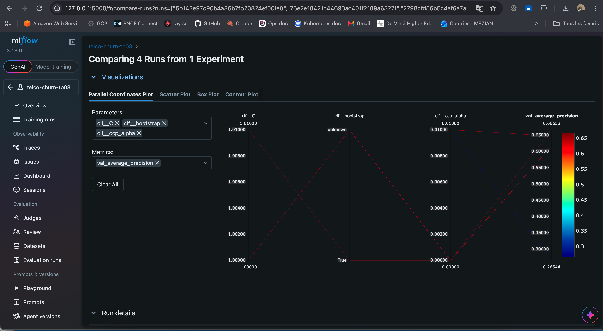
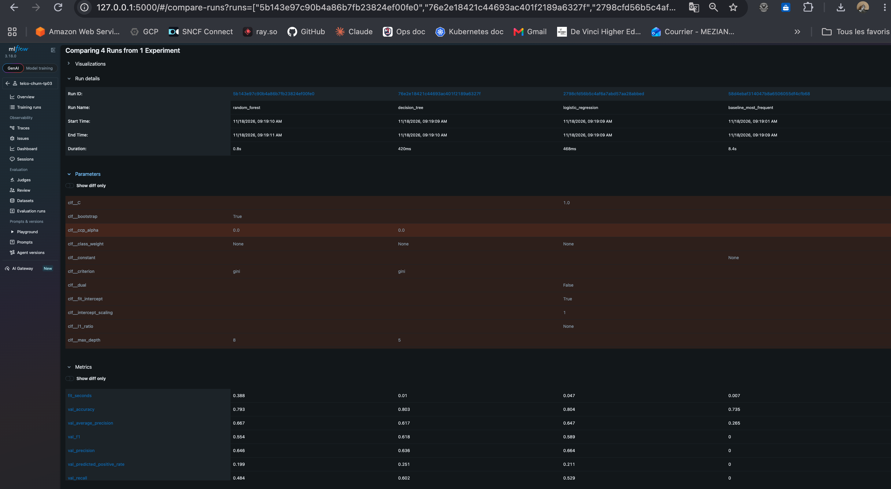
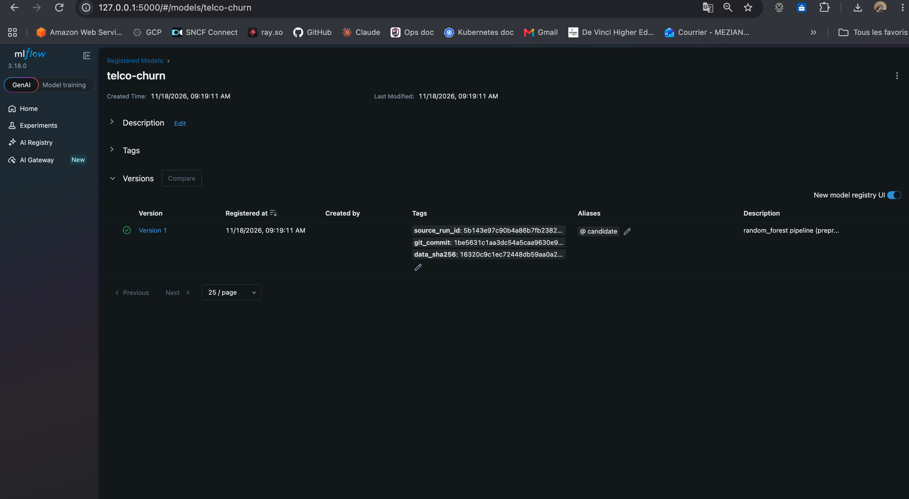

# TP03 summary - MLflow tracking, registry and recovery

Team: Elyas MEZIANI, Michael LI, Amin RACHID. Generated on 2026-11-18T08:33:25+00:00.

## 1. Candidate comparison and selection table



Experiment `telco-churn-tp03` (id 1). Same six features, same TP02 customer allocation
(allocation SHA-256 `a981175e5fa0ef378bc7cea8b18f5db669157ad01a9f532239e30514bc791f16`), same threshold (0.5), validation split only.

| Run ID | Candidate / changed setting | Validation AP | Validation recall | Validation F1 | Decision |
|---|---|---:|---:|---:|---|
| `58d4ebaf314047b8a6506055df4cfb68` | baseline_most_frequent (DummyClassifier) | 0.2654 | 0.0000 | 0.0000 | baseline (never selected) |
| `2798cfd56b5c4af6a7abd57aa28abbed` | logistic_regression (LogisticRegression) | 0.6475 | 0.5294 | 0.5893 | rejected |
| `76e2e18421c44693ac401f2189a6327f` | decision_tree (DecisionTreeClassifier) | 0.6173 | 0.6016 | 0.6181 | rejected |
| `5b143e97c90b4a86b7fb23824ef00fe0` | random_forest (RandomForestClassifier) | 0.6665 | 0.4840 | 0.5535 | selected |

**Selection.** The primary metric was fixed in the TP02 config before training: validation average precision (AP),
computed from the continuous class-1 probability. The rule picks the best learned candidate, unless a simpler one is within
0.01 AP. `random_forest` has the best AP (0.6665), 0.0190 above
`logistic_regression` (0.6475); the gap is larger than the tolerance, so the simpler model is not
preferred and `random_forest` is selected. `decision_tree` has the highest recall at threshold
0.5 (0.6016), but recall and F1 depend on the threshold, which was not tuned, while AP
summarises the ranking quality over all thresholds. The baseline only confirms the learned models beat the 26.5 % churn
prevalence. This is one split, so it is not proof of a statistically significant improvement; the test set is still unused.

## 2. Selected run



## 3. Registry



## 4. Identifiers

| Identifier | Value | Question it answers |
|---|---|---|
| Source run ID | `5b143e97c90b4a86b7fb23824ef00fe0` | Which execution produced the model? |
| Logged model URI | `models:/m-b71601c46a744854ad1b08fd20e434cb` | Which recorded model artifact to load? |
| Registered name + version | `telco-churn` version `1` (`models:/telco-churn/1`) | Which version of the managed model? |
| Alias | `candidate` -> version `1` (`models:/telco-churn@candidate`) | Which version currently holds this role? |
| Git commit | `1be5631c1aa3dc54a5caa9630e997884f0c83091` (uncommitted code changes: false) | Which code? |
| Original data SHA-256 | `16320c9c1ec72448db59aa0a26a0b95401046bef5d02fd3aeb906448e3055e91` | Which CSV bytes? |

## 5. Fresh-process inference and agreement

```sh
uv run python scripts/predict_registry.py
```

Separate Python process, no `fit`, no training import. It loads `models:/telco-churn@candidate` (version 1,
source run `5b143e97c90b4a86b7fb23824ef00fe0`), re-scores the 25 validation reference records stored in the source
run, and compares them with the predictions recorded at training time:

- same customer IDs: True
- class predictions agree: True
- max absolute score difference: 1.11e-16 (tolerance 1e-09)

It then scores `examples/new_customers.csv` with the TP02 parsing rules (`evidence/tp03/new_customers_predictions.csv`).

## 6. Restart observation and storage

The server was stopped (Ctrl+C) and restarted from the project root with the same command. After the restart, the
server still lists 4 runs in `telco-churn-tp03` (all 4 candidate runs present: True),
`telco-churn` version 1, and the alias `candidate` still resolves to version 1.
The inference command above was run again after the restart (check timestamp 2026-11-18T08:33:25+00:00) and agreed again.
Stopping the server stops the API and the UI only; the data lives in files.

**What do the database and the artifact store each preserve?**
`mlflow.db` (SQLite backend store) keeps the metadata: experiments, runs, parameters, metrics, tags, dataset input records
(name, digest, schema, context), logged-model records and the Model Registry (names, versions, aliases, tags). `mlartifacts/`
(artifact store) keeps the files: the pickled pipeline with its `MLmodel`, signature, input example and requirements, plus the
confusion matrices, `provenance.json`, the split allocation and the reference predictions. If only the database survived, every
record and ID would still be listed but loading the model (and opening any artifact) would fail, because the files the records point
to are gone. If only the model files survived, the pickle could perhaps be loaded by path, but nothing would say which run, parameters,
metrics, data hash, commit, version or alias it belongs to: no traceability and `models:/telco-churn@candidate` would not resolve.

**What must a colleague on another machine obtain separately?**
A run ID or a `models:/` URI only means something on this tracking server, which listens on 127.0.0.1. A colleague needs access to the
same server (a shared team server) or a copy of both `mlflow.db` and `mlartifacts/`; the repository at commit
`1be5631` with `uv.lock` to rebuild a compatible environment (cloudpickle needs compatible Python, scikit-learn
and churnlab versions); and the original CSV itself (downloaded with `scripts/download_data.py` and checked against its SHA-256), since
neither the hash nor the MLflow dataset record stores the data. Here none of this is shared yet: this limitation is documented, not solved.
